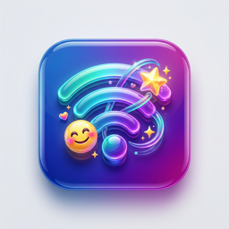
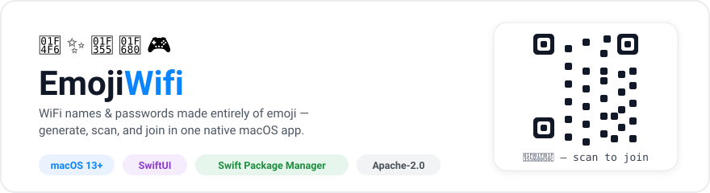
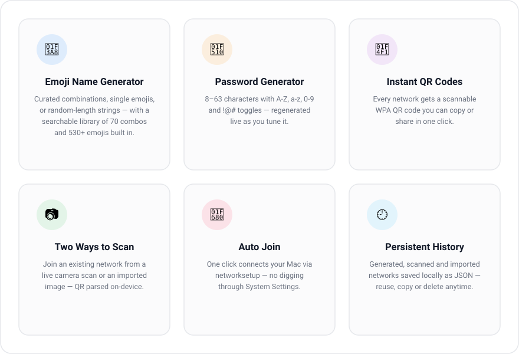
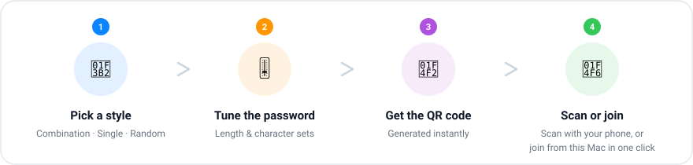
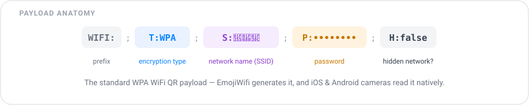

<div align="center">



# EmojiWifi

**WiFi names & passwords made entirely of emoji** 📶✨

Generate, scan, and join — in one native macOS app.




</div>

## What is EmojiWifi?

EmojiWifi turns your WiFi network into something worth reading. Instead of
`FritzBox4711_5GHz`, your guests see `🍕🚀🌌` or `🎮👾🤖` — the app generates an
emoji-only network name and a strong random password, renders a scannable QR
code, and can even join the network for you. It also reads WiFi QR codes back:
point your Mac's camera at one, or drop in an image file, and EmojiWifi parses
it into SSID and password instantly.

## ✨ Features



- **1,364 emojis, zero repeats** — the full Unicode 14.0 catalog (the same
  filtered set as the Windows app: no flags or skin-tone variants, which show
  up as broken boxes on some devices), organized into 8 categories and
  searchable by name. Type "pizza", meet 🍕 instantly.
- **Emoji Picker that remembers** — emojis that appear in any of your past
  network names are dimmed; one checkbox hides them entirely; and the
  Generate button skips your greatest hits by default.
- **Three name styles** — curated emoji combinations (70 built in, plus themed
  combos auto-generated per category), single emojis, or random-length
  strings, always within the 32-byte SSID limit every phone can display.
- **Tunable passwords** — 8–63 characters with independent A-Z / a-z / 0-9 /
  `!@#` toggles, regenerated live as you adjust. Every selected character
  class is guaranteed to appear.
- **QR codes, both directions** — every generated network gets a WPA QR code
  with properly escaped `\ ; , : "` characters (strong passwords can't break
  it), and the scanner accepts camera frames or imported images via Apple's
  on-device QR detection.
- **Auto Join** — one click runs `networksetup` to connect your Mac to the
  generated or scanned network. (Windows can't do this — Mac-only.)
- **Persistent history** — your last 50 generated, scanned, or imported
  networks are stored locally as JSON
  (`~/Library/Application Support/EmojiWifi/history.json`) with reuse, copy,
  and delete actions.

## 🔄 How it works



## 🔐 The QR payload

EmojiWifi speaks the standard WiFi QR format, so codes it produces work with
any modern phone camera — and codes produced by your router work with
EmojiWifi's scanner.



## ⬇️ Download & Install

**[Download the latest EmojiWifi DMG](https://github.com/dparksports/emoji-wifi-mac/releases/latest/download/EmojiWifi.dmg)**
(or the [zip](https://github.com/dparksports/emoji-wifi-mac/releases/latest/download/EmojiWifi.zip),
with [SHA-256 checksums](https://github.com/dparksports/emoji-wifi-mac/releases/latest) for both)

1. Open the DMG and drag `EmojiWifi.app` into your `/Applications` folder.
2. **First launch — one honest note:** the app is *ad-hoc signed*, so macOS
   will say it "can't be opened because Apple cannot check it for malicious
   software." That's how macOS treats every app without a paid Apple
   notarization ticket — our code is open, anyone can read it right here in
   this repository. To open it: **System Settings → Privacy & Security →
   Open Anyway** (on macOS 13/14: right-click the app → Open → Open). You
   only do this once.
3. Generate away. Notarization (which removes the notice) is on the roadmap.

> The live camera scanner needs camera permission; macOS will ask on first use.

## 🛠️ Build from Source

Built with SwiftUI and Swift Package Manager — no Xcode project required.

**Requirements:** macOS 13+ and Xcode Command Line Tools
(`xcode-select --install`) with a Swift 6 toolchain.

```bash
git clone https://github.com/dparksports/emoji-wifi-mac.git
cd emoji-wifi-mac
swift test          # run the unit tests
./build-app.sh      # build + bundle + ad-hoc sign
open EmojiWifi.app
```

The script compiles in release mode, assembles `EmojiWifi.app` (binary,
resource bundle, icon, `Info.plist`), and ad-hoc signs it.

> **Note for Command Line Tools 27 users:** the macOS 27 SDK implements
> SwiftUI's `@State` as a macro, but the CLT — unlike full Xcode — does not
> ship the `SwiftUIMacros` plugin it needs. `build-app.sh` detects this and
> automatically builds against the last SDK without the macro
> (`MacOSX26.5.sdk`), so builds work out of the box.

## 🗂️ Project Layout

```
emoji-wifi-mac/
├── Sources/EmojiWifi/
│   ├── ContentView.swift      # App entry point, sidebar tabs, generate view
│   ├── Views.swift            # Camera scanner, image import, UI components
│   ├── EmojiPickerView.swift  # Category/search picker with used-emoji dimming
│   ├── EmojiGenerator.swift   # Catalog loading, name generation, used tracking
│   ├── WiFiQRPayload.swift    # Escaped WIFI: QR payload build/parse
│   ├── Models.swift           # Password gen, QR gen, WiFi joiner, history
│   ├── EmojiCatalog.json      # 1,364 emoji (Unicode 14.0, filtered)
│   ├── single.csv             # 533 emoji → description fallback dataset
│   └── combos.csv             # 70 curated emoji combinations
├── Tests/EmojiWifiTests/      # Payload escaping, passwords, catalog, history
├── .github/workflows/         # CI (test + bundle check) and release (DMG + zip)
├── build-app.sh               # Build + bundle + sign script (./build-app.sh --dmg for a DMG)
├── EmojiWifi.icns             # App icon
└── docs/                      # Infographics used in this README
```

The emoji catalog is generated from Unicode's official `emoji-test.txt` by
`tools/generate_emoji_catalog.py` in the
[Windows repo](https://github.com/dparksports/emoji-wifi-windows) — both apps
share the exact same filtered catalog.

## 🌍 The EmojiWifi family

EmojiWifi exists on three platforms, kept consistent on purpose:

| | 🍎 Mac | 🪟 [Windows](https://github.com/dparksports/emoji-wifi-windows) | 🐧 [Ubuntu](https://github.com/dparksports/emoji-wifi-ubuntu) |
|---|---|---|---|
| Emoji pool | 1,364 | 1,364 | smaller set |
| Categories + search picker | ✅ | ✅ | — |
| Used-emoji dimming / skip-used | ✅ | ✅ | — |
| Themed combinations | ✅ | ✅ | — |
| Strong passwords (8–63, class-guaranteed) | ✅ | ✅ | ✅ |
| Escaped WiFi QR payloads | ✅ | ✅ | — |
| Scan: image import | ✅ | ✅ | — |
| Scan: live camera | ✅ | — | — |
| **Auto Join network** | ✅ | — | — |
| Offline, no telemetry | ✅ | ✅ | ✅ |
| Install size | ~5 MB | ~70 MB | tiny |

Bug reports and ideas welcome — see [SUPPORT.md](SUPPORT.md) for quick
answers and [CHANGELOG.md](CHANGELOG.md) for what changed.

## 🗺️ Roadmap

- Apple notarization (removes the first-launch notice entirely)
- Auto-updates (Sparkle)
- Menu-bar mode
- Save password to iCloud Keychain
- Homebrew cask (`brew install --cask emoji-wifi`)

## 📜 License

[Apache License 2.0](LICENSE) — feel free to use and modify it!
